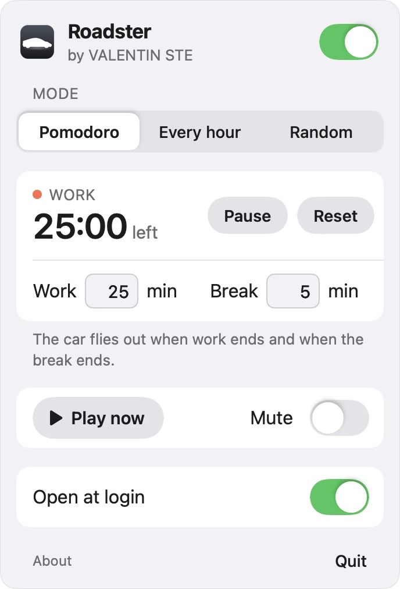

# Roadster

**A car that flies across your Mac.** A free menu bar app for macOS: on a timer or at a click, a photoreal roadster
drives onto your desktop, lifts off on jets of steam, flips, lands in its own cloud and dashes away, with sound.

<p align="center">
  
</p>

<p align="center"><a href="https://flying-roadster.pages.dev"><b>Watch it fly on the website →</b></a></p>

The animation above plays the show over a plain sky so that it fits a page. The app plays it over your desktop and
your windows, with a transparent background and the car's shadow on the desktop.

## Download

- **[flying-roadster.pages.dev](https://flying-roadster.pages.dev)**: the Download for Mac button, or
- **[GitHub Releases](https://github.com/valentin-ste/flying-roadster/releases/latest)**: `Roadster.zip` (the release also
  holds `roadster-clips.zip`, the two movies a build from source downloads).

macOS 13 Ventura or later, Apple silicon or Intel. 18.6 MB.

## Features

- **Three schedules.** *Pomodoro*: a show at the end of every focus session and every break (25 and 5 minutes, or your
  own). *Every hour*: on the hour, by your Mac's clock. *Random*: at a random moment after the last show, 30 to 90
  minutes by default or any range from 1 minute up to 10 hours.
- **Play now** whenever you want it, **Mute** for the same flight without sound, **Open at login** (on by default).
- **Lives in the menu bar**, no Dock icon. Click the little car at the top of the screen to choose when it flies.
- **Never in your way.** Clicks pass right through the car, it never takes the keyboard, and it flies over every
  Space and over full-screen apps. No shows while your Mac sleeps, its screens are off, the screensaver runs or the
  screen is locked; a pomodoro waits meanwhile.
- **Photoreal.** Rendered in Blender's Cycles from a real-scale physics simulation: volumetric steam, motion blur, the
  car's shadow on your desktop, a soundtrack built from the same flight.
- **Private and small.** The app never goes online: no account, no ads, no analytics. One universal app (Apple
  silicon and Intel), Apple's frameworks only.

<p align="center">
  <picture>
    <source media="(prefers-color-scheme: dark)" srcset="docs/panel-dark.webp">
    
  </picture>
</p>

## Install on macOS

1. **Unzip.** Double-click `Roadster.zip` in Downloads. Safari may have unzipped it already.
2. **Open Roadster.** macOS says it can't verify the developer. Click **Done**, not Move to Trash.
3. **Open Anyway.** Open **System Settings → Privacy & Security**, scroll down and click **Open Anyway**. Confirm.
4. **Move to Applications.** Roadster offers to move itself there. Click **Move to Applications**, and the car is in
   your menu bar.

**Why the warning?** Roadster is free and isn't signed or notarized through a paid Apple developer account, so macOS
can't confirm who made it. That is all the warning is about. The code is open: you can read what the app does, or
build it yourself (below), and then macOS doesn't ask at all.

**Why Applications?** A copy opened straight from Downloads runs from a temporary, read-only place (App
Translocation), and a login item that points there breaks. So Roadster asks to move itself on every launch from
anywhere else, and Open at login works from the Applications folder only.

To uninstall, turn Open at login off, quit Roadster from its panel and move it from Applications to the Trash; its
settings are in `~/Library/Preferences/com.valentinste.roadster.plist`.

## How it works

The car is never drawn live. The show is rendered once, ahead of time, from a physics simulation; the app only plays
two movies with a transparent background at the right moment.

```
src/physics.js              the flight in metres and seconds (Rapier: a rigid body and a raycast vehicle)
   │  tools/export_motion.mjs
   ▼
motion.json                 per frame at 60/s: the car's position and turn, each wheel, the thrust of 10 nozzles
   │  tools/blender/landing_jets.py   (+ car_shot.py: the car, jet_probe_a2.py: the jet)
   ▼
three layers per frame      the car's silhouette · the car lit by its steam · the jets and clouds at half size
   │  tools/landing_merge.py      the steam over the car in linear light, Blender's AgX look
   │  tools/desktop.py layers     the car's shadow on the desktop
   │  tools/show_b.py split       two clips, cut where nothing moves, and the pause between them
   ▼
transparent frames ─────────┐
motion.json ── tools/show_b_sound.py ──► a sound track per clip
   │                        │
   ▼                        ▼
tools/mac/show_video.swift  clip1.mov, clip2.mov: HEVC with alpha + AAC, 60 frames/s
   │  tools/build_mac_app.sh
   ▼
Roadster.app                a menu bar app that plays them in a transparent window that clicks pass through
```

**The physics** (`src/physics.js`, data in `src/models.js`). The Roadster at its real size (4.2 m) and weight on
[Rapier](https://rapier.rs), g = 9.81. Ten nozzles: four lift jets under the floor inboard of the wheels, four in the
rear diffuser for the dash, two small side jets that roll the car through the flip. An imperfect autopilot flies it:
40 ms late, jets that take time to spool up, 50 ms pulses, gusts. The show: drive in, lift off on four jets, a
kickflip on side-jet pulses, hover, descend into its own cloud, touch down, brake to a stop, stand while the cloud
melts, then dash off on the rear jets. It is deterministic (seeded gusts), so `tools/physics_regress.mjs` checks every
frame of every show against `tools/physics_regress/*.json` to the last digit; `tools/tune_physics.mjs` prints a show's
numbers without rendering. `tools/export_motion.mjs` writes the flight as `out/show-b/motion.json` in Blender's axes.

**The scene** (`tools/blender/`). The frame is the whole screen of a 14-inch MacBook Pro at 2x, 3024 × 1964 px, at
216 px per metre: 14 m of desktop, the floor at its bottom edge, seen from the side by an orthographic camera.
`car_shot.py` builds the car from the Sketchfab model and keys it frame by frame from `motion.json` (wheels spinning,
suspension, motion blur), in a neutral studio light. `jet_probe_a2.py` holds the look of the jet: a simulated gas leak
from Blendkit made into a 3 m jet with a bright core and a bluish haze. `landing_jets.py` puts that jet on every nozzle,
as strong as its thrust and with the asset's own switching on and off, and grows a cloud where the lift jets hit the
floor: a churning middle and an outer cloud rolling along the floor, pushed out for as long as the jets reach it, then
melting over 3 seconds.

**The layers.** Rendering the steam is what costs, so each frame is three renders: the car's silhouette (Eevee, for the
desktop shadow), the car at full size lit by its steam (the steam lights, reflects and shows through the glass, but
the camera doesn't see it), and the steam at half size with the car hiding what is behind it. `landing_merge.py`
scales the steam up and lays it over the car in linear light, cleans the steam's noisy edges and applies the same AgX
look Blender would; `desktop.py` adds the shadow the car casts on your desktop; `frame_blinks.py` lists any frame unlike
both its neighbours to look at. `show_b.py` cuts the show in two where nothing moves (frame 660: the car stands, the
cloud is gone), so the app can hold that frame for a moment before the dash (`pause_s` in `split.json`, changed
without rendering anything). `tools/show_b_final.sh` runs all of it, pass by pass, and goes on where it stopped.

**The sound** (`tools/show_b_sound.py`, `tools/show_b_sound.toml`, `sounds/`) is built from the same `motion.json`:
the hiss of each group of jets follows its thrust and darkens as it falls, a valve cracks at every ignition and chuffs
at every cutoff, the lift-off and the dash hit, the tyres, the brakes and the motor follow the speed, the wheels thud
down at the touchdown, everything panned to where it is on the screen, in a small synthetic room, brought to −18 LUFS
under a −1 dBTP ceiling. The `.toml` holds three variants as blocks of numbers; the app plays `b`.

**The movies.** `tools/mac/show_video.swift` packs each clip's frames and sound with VideoToolbox: HEVC with alpha
(premultiplied, BT.709 primaries with the sRGB transfer, so it looks like the PNGs), AAC at 256 kbit/s, 18 MB for
both. Its `check` decodes them as the Mac does and prints the difference from the frames.

**The app** (`mac/`: Swift, AppKit and SwiftUI, no Xcode project). It plays clip 1, holds its last frame for
`pause_s`, plays clip 2 and lets its sound fade out, in a borderless, transparent window above the Dock and the menu
bar (under open menus) that clicks pass through. The frame is scaled whole to the largest size that fits the screen
and stands on its bottom edge (`defaults write com.valentinste.roadster FloorAboveDock -int 1` puts the floor on top
of the Dock). `Schedule.swift` keeps the three schedules as moments on a clock it is given, so its tests
(`mac/Tests`, 107 checks) run on a clock of their own; `ModeTimer.swift` wires it to one strict timer and to sleep,
the screens, the screensaver and the lock; `Mover.swift` moves the app to Applications; the panel is in `Panel.swift`.

## Build from source

```sh
git clone https://github.com/valentin-ste/flying-roadster.git && cd flying-roadster
tools/build_mac_app.sh
```

You need macOS 13 or later with the Xcode Command Line Tools (`xcode-select --install`). In a fresh clone the
script downloads the two movies once from the release (`roadster-clips.zip`, 17.6 MB: `clip1.mov`, `clip2.mov`,
`split.json`; the address is `CLIPS_URL` at the top of the script, checked by its SHA-256), runs the schedule's tests,
compiles the app for Apple silicon and Intel and signs it ad hoc: `dist/Roadster.app` and `dist/Roadster.zip`, in
about 25 seconds on an M1 Pro. `open dist/Roadster.app` starts it; an app you built yourself opens without the
warning.

Checks:

```sh
dist/Roadster.app/Contents/MacOS/Roadster --selftest       # plays the show once and logs it in numbers: exit 0 = OK
dist/Roadster.app/Contents/MacOS/Roadster --snapshot DIR   # the panel in every state, light and dark, as PNGs
/usr/bin/log stream --predicate 'subsystem == "com.valentinste.roadster"'   # what the app is doing
npm ci && npm test                                         # the physics against its references (Node 20 or later)
```

## Re-render the show from scratch

Everything in the release can be made again from this repository and free downloads from three sites. It takes a Mac,
a night and a morning, and about 15 GB of disk.

**You need**

- a Mac with Apple silicon (the show was rendered on an M1 Pro, Metal);
- [Blender](https://www.blender.org/download/) 5.2 (5.2.3 LTS was used) in `/Applications`, or its path in `BLENDER`;
- [Node.js](https://nodejs.org) 20 or later;
- Python 3.11 or later with numpy, Pillow and SciPy:
  `python3 -m venv .venv && .venv/bin/pip install -r requirements.txt` (the scripts use `.venv/bin/python3`, or
  `PYTHON`);
- [FFmpeg](https://ffmpeg.org) (`brew install ffmpeg`);
- free accounts on [Sketchfab](https://sketchfab.com) and [Blendkit](https://www.blendkit.com).

**The assets**, none of them kept in this repository:

| What | Where it goes | Source and licence |
|---|---|---|
| The car | `assets/models/roadster/tesla-roadster-2020.glb` | [Tesla Roadster 2020](https://sketchfab.com/3d-models/tesla-roadster-2020-1fbf29e297bd4a17ac39a00a378441d8) by metarex.4d, Sketchfab, CC BY 4.0 |
| The jet | `work/blendkit/pipe-leak/extracted/caches/(A) Pipe Leak/` (550 VDB frames, 1.4 GB) | [Pipe Leak Animated](https://www.blendkit.com/asset-gallery-detail/4f54310c-5e38-41dd-8240-1e0a353788ad/) by BleachedBroccoli Medvešek, Blendkit, Royalty Free |
| The cloud's rolling edge | `work/blendkit/rolling-ground-smoke/extracted/caches/(L) Rolling Ground Smoke/` (300 frames, 1 GB) | [Rolling Ground Smoke Looped](https://www.blendkit.com/asset-gallery-detail/1a80bc93-b28f-4425-8867-97d719d294e9/), the same author and licence |
| The cloud's middle | `work/blendkit/chaotic-ground-smoke/extracted/caches/(L) Ground Smoke/` (300 frames, 4 GB) | [Chaotic Ground Smoke Looped](https://www.blendkit.com/asset-gallery-detail/082f8fbb-94a3-4acf-bc01-476b754582bb/), the same author and licence |
| The light | `assets/hdri/studio_small_09_1k.hdr` | [Studio Small 09](https://polyhaven.com/a/studio_small_09) by Sergej Majboroda, Poly Haven, CC0 |
| The desktop (optional) | `assets/bg/tahoe-day.jpg` | a frame of macOS Tahoe's own wallpaper, for the preview videos only; plain grey without it |

The Blendkit license allows renders in any work but not passing the assets on, so everyone downloads them with their
own account. `tools/fetch_assets.sh` does all of it: give it your Sketchfab API token (Settings → Password & API) as
`SKETCHFAB_API_TOKEN` and your Blendkit API key (your profile) as `BLENDKIT_API_KEY`, or keep them in the Keychain as
`sketchfab-api-token` and `blendkit-api-key`. It never prints them, keeps whatever is already in place, and without a
key tells you what to download by hand and where to unzip it. The volumes go to `work/` (3.1 GB of zips, 6.4 GB
unpacked); set `ROADSTER_WORK` to put them elsewhere, the render reads the same variable.

**The commands**, from the repository's folder:

```sh
npm ci
tools/fetch_assets.sh                                      # the car, the light, the volumes: a few minutes to an hour
npm test                                                   # the physics as released: OK
node tools/export_motion.mjs b 12.5 out/show-b/motion.json # the flight, about a second
tools/show_b_final.sh --cloud --range 300:302 --draft --out out/show-b/final-check   # the whole chain on 3 frames
tools/show_b_final.sh --cloud --smoke-step 8               # the show: about 15 hours on an M1 Pro
.venv/bin/python3 tools/show_b_sound.py b                  # the sound, about a second
tools/build_mac_app.sh --video                             # the movies from your frames, then the app
```

`show_b_final.sh` writes everything to `out/show-b/final-cloud/` (3.2 GB): the silhouettes, the two layers, the merged
frames, the shadow, the frames with the shadow, the two clips and `split.json`, and `out/show-b/show-b-cloud.mp4` to
watch. The released show took 14 h 38 min on an M1 Pro: the car lit by its steam 5.5 hours, the steam 9 hours, the
rest minutes; the first run also prepares the jet's volumes in `work/jet-probe-a3/vdb` (1.2 GB). Stopped, it goes on
where it was when you run it again, and it waits while the Mac is on battery. Without `--cloud` it renders the show
without the clouds, in about 2 hours. `show_b_sound.py` with no variant builds all three of the `.toml`, each with a
video to listen to.

**Reading the code.** The comments explain why each number is what it is, and they name the tests it took to get
there: earlier probes and tools of the author's working copy that are not in this repository because the show doesn't
need them (the first look tests in a browser engine: `src/main.js`, `src/jet3d.js`, `src/dropshadow.js`; the jet and
cloud probes `jet_probe.py` and `cloud_probe_b.py`; the measuring and comparison tools `jet_measure.py` and
`*_sheet.py`; `landing_final.sh`, the landing alone). The names come from that history too: `landing_jets.py` renders
the whole show because the landing was its first clip, the jet is the one approved in probe A2, its prepared volumes
sit in `work/jet-probe-a3/`, and `src/models.js` still lists the placeholder car of the first look tests. `design/`
holds the HTML mock-ups the panel was built from (its colours are those of Just the Video, the author's browser
extension) and the scripts that drew the icons from frame 600 of the show.

## Repository

```
mac/                     the menu bar app: Sources/*.swift, Tests/ScheduleTests.swift, Info.plist
src/                     physics.js, models.js: the flight and the car's dimensions
tools/
  build_mac_app.sh       builds dist/Roadster.app and dist/Roadster.zip
  fetch_assets.sh        downloads the assets a re-render needs
  export_motion.mjs      the physics -> motion.json
  physics_regress.mjs    the physics against physics_regress/*.json
  tune_physics.mjs       a show's numbers, without rendering
  blender/               car_shot.py, jet_probe_a2.py, landing_jets.py: the scene
  show_b_final.sh        the render, pass by pass
  landing_merge.py       the steam over the car (runs in Blender's Python)
  desktop.py             the desktop shadow, the wallpaper behind the previews
  frame_blinks.py        frames unlike both neighbours
  show_b.py              the two clips, the pause, the preview video
  show_b_sound.py/.toml  the sound
  mac/                   show_video.swift (the movies), render_icon.swift (the app icon)
sounds/                  the nine CC0 recordings the sound is made of
design/                  the icons and the panel's mock-ups
docs/                    the pictures of this page
```

## Credits and licences

| Part | Author | Licence |
|---|---|---|
| Car model "Tesla Roadster 2020" | [metarex.4d](https://sketchfab.com/metarex.4d), Sketchfab | [CC BY 4.0](https://creativecommons.org/licenses/by/4.0/), changed: scaled, wheels rigged, materials tuned |
| "Pipe Leak Animated", "Rolling Ground Smoke Looped", "Chaotic Ground Smoke Looped" | BleachedBroccoli Medvešek, Blendkit | Blendkit Royalty Free; rendered from, not redistributed |
| HDRI "Studio Small 09" | Sergej Majboroda, Poly Haven | CC0 |
| Nine sound recordings (`sounds/`) | craigsmith, SukritSen, magnuswaker, Sheyvan, TylerAM, Topschool, Freesound | CC0 |
| Rapier physics engine | Dimforge | Apache-2.0 |
| The code of this repository | VALENTIN STE | [MIT](LICENSE) |
| The show's movies and frames, its sound mix, the icons, the brand | VALENTIN STE | © 2026, only as part of this app ([LICENSE-MEDIA.md](LICENSE-MEDIA.md)) |

Every source, link and change in detail: [CREDITS.md](CREDITS.md).

## License

The code is [MIT](LICENSE). The show's movies and frames, its sound as mixed into them, the icons and the VALENTIN STE
brand are © 2026 VALENTIN STE and may be used only as part of this program ([LICENSE-MEDIA.md](LICENSE-MEDIA.md)).
Third-party assets keep their own licences ([CREDITS.md](CREDITS.md)).

Not affiliated with Tesla, Inc. Tesla and Roadster are trademarks of Tesla, Inc. Mac and macOS are trademarks of
Apple Inc.

## Windows

In development.

## Author

**VALENTIN STE** — [x.com/valentinste_dev](https://x.com/valentinste_dev)
